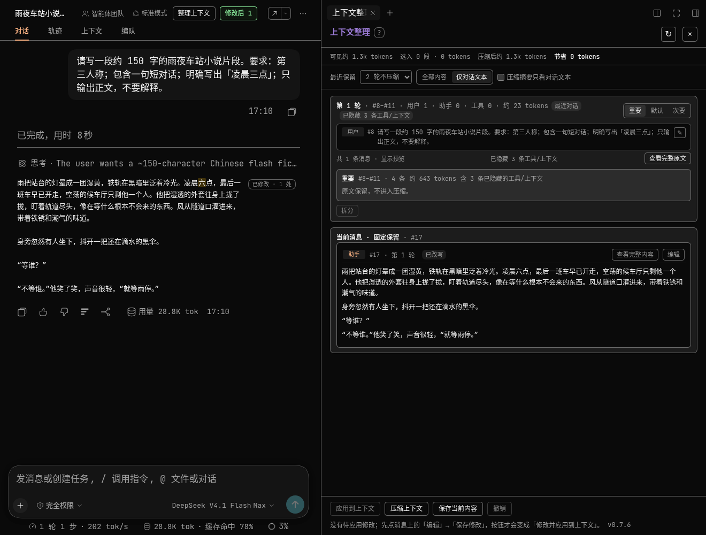
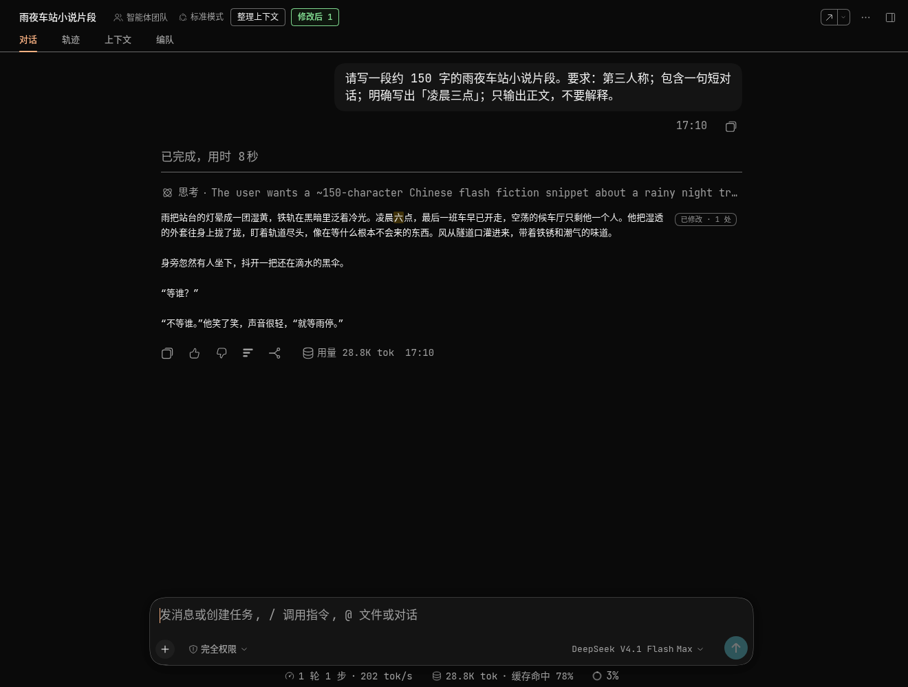
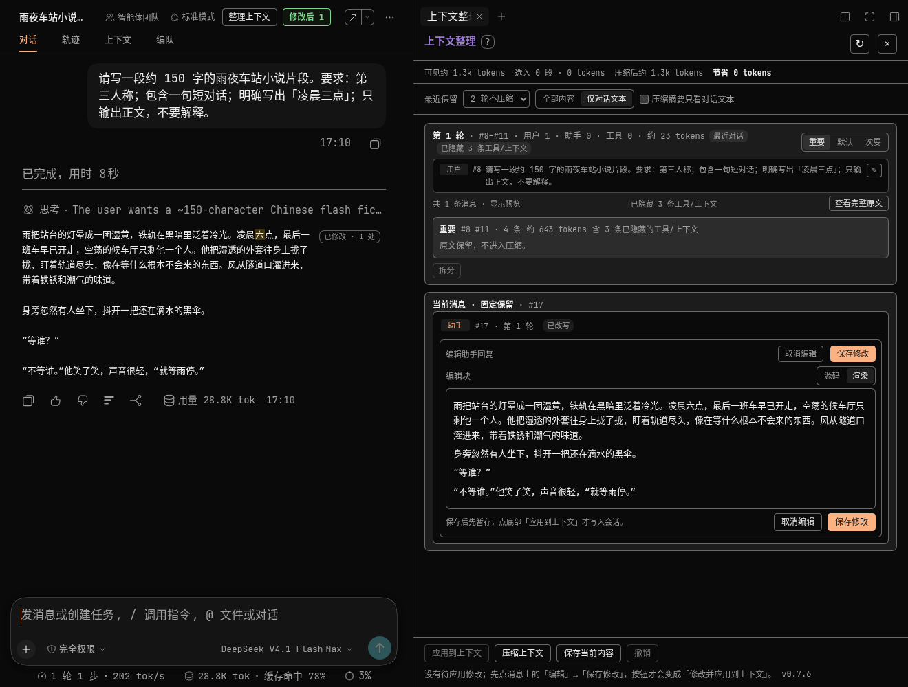
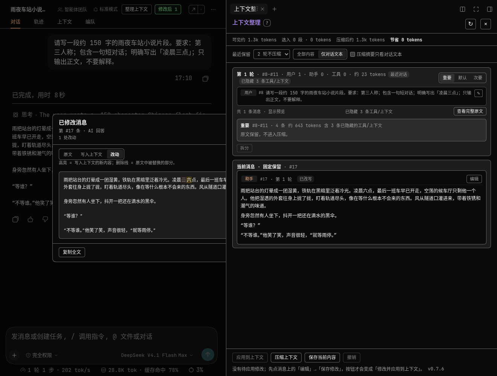
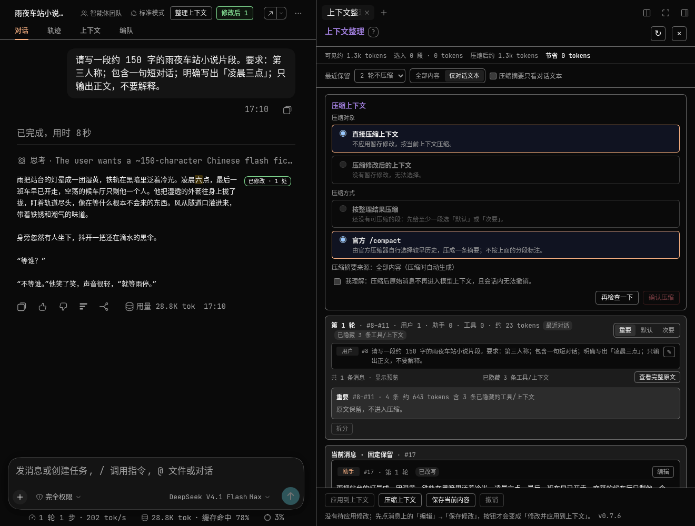
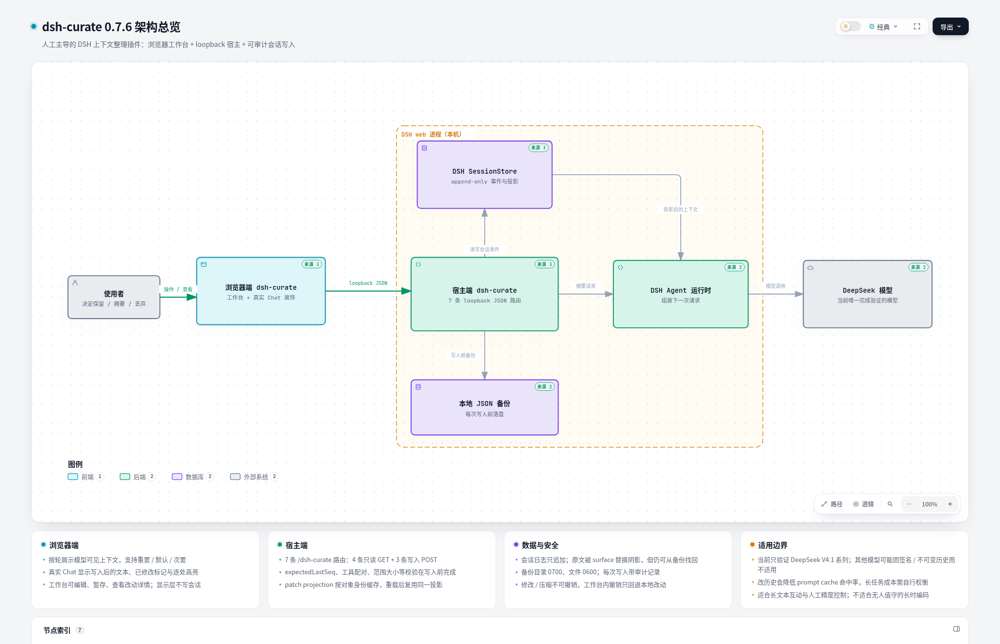

# dsh-curate

**人工主导的 DeepSeek Harness 上下文整理工作台。**

把模型可见的会话按轮拆开，由人决定哪些内容**原文保留**、哪些**生成摘要**、哪些**直接丢弃**；也可以直接改写用户消息、助手回复、思维链、工具结果和注入上下文。所有写入都先落本地 JSON 备份，并在真实 Chat 中显示实际进入上下文的文本、改动位置和原文对照。

> English: a human-in-the-loop context curation workbench for DeepSeek Harness. Triage turns, rewrite messages in place without a model call, display the applied text in the real transcript, and compress the marked history with a local backup before every write.

[](CHANGELOG.md)
[](docs/QA-0.7.6.md)
[](package.json)
[](#模型支持范围)
[](LICENSE)



## 为什么需要它

长对话里最贵的不只是 token，还有**判断力**：

- 工具输出、运行日志、重复解释会挤占真正重要的上下文；
- 自动压缩不知道哪一句是需求、哪一句是过期草稿，容易把决定压掉；
- 只靠“再问一遍”无法纠正已经写进历史的错误措辞。

dsh-curate 不替人做自动摘要，而是把**模型可见的 surface** 摊开给人看：人可以精确保留、精确改写、按区间压缩，并清楚知道最后写进上下文的是什么。

## 功能

- **按轮整理**：把当前模型可见消息切成轮卡片，最后一条消息固定保留；支持最近 N 轮不压缩。
- **重要 / 默认 / 次要**：重要=原文保留；默认=压缩时生成常规摘要；次要=直接丢弃并只留一条省略标记。支持整轮批量设置，也支持单条覆盖。
- **原地改消息**：用户消息、助手正文/思维链、工具结果、注入上下文都能编辑；保存只是暂存，点「修改并应用到上下文」才写入，**不调用模型**。
- **真实 Chat 回显**：写入后 Chat 直接显示实际上下文里的文本；标题旁可在「修改后 / 原文」间切换。
- **逐处高亮**：改写/新增的词句在 Chat 中高亮；纯删除显示「原文删除 N 字」提示；「已修改 · N 处」标记可打开完整对照。
- **改动详情**：详情层提供「原文 / 写入上下文 / 改动」三种视图；「改动」用高亮 + 删除线展示前后差异，可复制全文。
- **两种压缩**：按标记区间压缩（重要保留，默认生成摘要，次要丢弃），或调用当前 agent 预设的官方 `/compact`。
- **先备份再写**：应用修改、压缩、官方 compact 前都写本地 JSON 备份；每次写会话都有审计记录。
- **本地草稿**：语气、视图、暂存修改自动保存在浏览器本地；可手动保存/清除，不写会话。
- **中英界面**：跟随 DSH 客户端语言；工作台和真实对话标记都做了本地化。

## 界面案例

### 真实对话中的修改与标记

写入后 Chat 显示「凌晨六点」并高亮「六」；右上角「已修改 · 1 处」可打开全文对照，顶部「修改后 1」可切回原文。



### 编辑器：顶部和底部都有取消/保存

长文本编辑时不用再往下找按钮；顶部和底部是同一组 `onCancel` / `onSave`。



### 改动详情：高亮新文本、删除线旧文本



### 压缩预览

按整理结果压缩，或选择官方 `/compact`；确认前必须勾选不可撤销提示。



## 架构



交互式版本（自包含 HTML，支持明暗主题和节点详情）：[`docs/architecture.html`](docs/architecture.html)

主流程：

1. 浏览器端工作台通过 **7 条 loopback JSON 路由**读取 surface、提交修改或压缩请求；显示层只读 `GET /dsh-curate/changes`，不直接写会话。
2. 宿主端先在内存中校验 `expectedLastSeq`、工具调用的配对关系、范围和消息可编辑性，再写 JSON 备份。
3. 修改以 `plugin:dsh-curate/patch` 记录 + 消息投影写入 append-only 会话日志；用户提示词使用官方 surface replacement。
4. DSH Agent 在下一次请求中看到投影后的上下文；只有「按整理结果压缩」会额外调用模型生成摘要。
5. 真实 Chat 的显示层在浏览器侧装饰 DOM，关闭插件或刷新即可恢复宿主原始 HTML。

## 快速开始

**要求**

- DSH **0.2.1-rc.x**（`engines.dsh >= 0.2.1-rc.2`，已在 `0.2.1-rc.2` 验证）
- Node.js **≥ 22**
- 当前仅验证 **DeepSeek** 模型（见下文）

从 GitHub 安装（`lib/` 已预构建，安装时不需要编译）：

```bash
dsh plugin --profile web add github:111222cjyq/dsh-curate
```

安装后**重启 `dsh web` 并硬刷新页面**。宿主插件在启动时加载，浏览器端 bundle 也需要刷新。

> **升级提醒**：不要在会话打开时反复 disable/enable 插件。DSH 的 live session 会记住消息投影对象；完整重启 `dsh web` 才能安全地重新加载插件。0.7.5 起已缓存投影对象以降低热重载风险，但已经失效的旧会话仍需重启一次。

更多安装方式（本地开发、桌面端）和配置项见 [`docs/USAGE.md`](docs/USAGE.md)。

## 使用流程

1. 打开会话，点会话头部「整理上下文」。
2. 工作台按轮展示当前模型可见消息；用「重要 / 默认 / 次要」标记每一轮或每条消息。
3. 需要改文字时，点消息的「编辑」或预览行铅笔；改完点编辑器**顶部或底部**的「保存修改」。行上出现「已修改（待应用）」。
4. 所有要改的消息暂存后，点底部「修改并应用到上下文」。成功后会显示备份路径，工作台和真实 Chat 重新同步。
5. 需要压缩时，点「压缩上下文」，选择「直接压缩」或「压缩修改后的上下文」，再选择「按整理结果压缩」或「官方 /compact」，勾选不可撤销确认后执行。
6. 下一条模型请求只会看到整理后的上下文。

> 三个按钮不要混淆：
>
> - **保存修改**：只暂存当前消息，不写会话；
> - **保存当前内容**：只保存本地草稿，不写会话；
> - **修改并应用到上下文**：真正写入会话。

## 模型支持范围

**当前只完成 DeepSeek 模型验证。** 开发和测试使用 DSH 的 DeepSeek V4.1 系列配置；没有对其他 provider 做兼容性承诺。

为什么有些大模型可能不适用：

- **推理签名 / thinking blocks**：部分模型要求 reasoning 内容带服务端签名，改写历史后签名与文本不一致，provider 可能拒绝请求；
- **不可变历史 / 服务端会话状态**：部分模型把历史保存在服务端，或要求严格的角色/消息顺序，客户端改写历史可能被忽略或报错；
- **缓存前缀**：修改历史会改变 prompt 前缀，依赖前缀缓存的模型会降低缓存命中；
- **消息格式约束**：不同 provider 对 tool 调用、注入上下文和 assistant 文本块的校验不同。

dsh-curate 的投影和显示层在 DSH 本地是正确的，但“本地投影成功”不等于“所有 provider 都接受改写后的历史”。**在非 DeepSeek 模型上请先做小规模验证，不要直接用于生产上下文。** 如果 provider 拒绝修改后的历史，回退到原文并从备份恢复。

## 上下文缓存与成本

这是使用本插件最重要的成本提醒：

- **改历史会降低 prompt cache 命中率**。修改越靠前，失效的缓存前缀越长；下一次请求可能从修改点开始重新 prefill，token 成本和首 token 延迟都会上升。
- **改尾部最便宜，改开头最贵**。如果只是纠正最近一轮的措辞，优先改最近消息；不要在长会话开头反复微调。
- **批量应用优于逐条应用**。把同一轮的修改一次暂存、一次应用，只需要让缓存失效一次。
- **压缩同样会改变前缀**，即使 token 总数下降，也可能损失缓存收益；长任务中应把“省 token”和“缓存命中”一起权衡。
- 每次写入后观察 DSH 的用量/缓存命中指标；在长编码循环前整理一次，通常比每轮都改更划算。

## 人的局限与正确用法

这个工具的前提是**人比自动摘要更懂什么重要**，但人也有明显局限：

- **长时编码任务**：工具调用、测试输出、文件变更会快速堆积；人很难持续跟踪每一条的时效性，逐条微调容易漏掉关键约束、制造前后矛盾。长编码任务更适合由 agent 自己维护上下文，人只在关键节点做一次整理。
- **长文本互动**：这是插件最适合的场景。可以有限地去除重复叙述、过期草稿、冗长工具噪音和非必要解释，同时保留需求、决策、精确标识符、错误信息、接口约定和最新指令。
- **人工控制是有边界的**：不要为了“看起来更短”而删除仍然有效的约束；不要频繁改动已稳定的历史；不要在没有备份和确认的情况下压缩不可恢复的区间。
- **精度优先于激进压缩**：不确定时标为「重要」保留原文；先用「仅对话文本」视图检查冗余，再决定压缩范围。

一句话：**它适合人机协作中的“有限、精确、可审计的上下文控制”，不适合替代自动上下文管理，也不适合无人值守的长时编码。**

## 安全与可恢复性

- 修改和压缩前写本地 JSON 备份，默认目录 `~/.local/share/dsh-curate/backups/<sessionId>/`，目录 `0700`、文件 `0600`；
- 会话日志 append-only；原文被 surface 替换阴影，但不会从日志消失；
- 应用前校验 `expectedLastSeq`，会话增长返回 `409 stale`；忙会话拒绝写入；
- 路由只监听 loopback，并校验 `Host` / `Origin`；
- 编辑不调用模型；只有「按整理结果压缩」会在确认后调用模型生成摘要；
- 每次写入产生 `edit-plan` / `edit-applied` / `plan` / `applied` / `compact` 审计记录。

备份路径、保留上限、provider/model 配置等细节见 [`docs/USAGE.md`](docs/USAGE.md)。

## 已知限制

- **显示层是 DOM 装饰**，依赖 DSH 的 `data-chat-flow-key` / `_markdown` 结构；DSH 升级若改动结构，标记会静默隐藏，但不影响会话本身。
- 内联显示使用**纯文本**（保留换行，Markdown 强调/标题标记会还原为文字），代码块/表格排版会简化；完整原文看详情层。
- 内联视图只显示写入后的文本，删除内容以「原文删除 N 字」提示；完整前后对照在「改动」视图。
- 不支持在工作台增删图片/文件附件；附件原样保留。
- 系统提示和工具调用参数保持只读。
- 压缩摘要的 Chat 展示、自动调度压缩、跨会话批量整理不在当前范围。
- 超长会话（800+ 可见节点）预览会缩短；一次展开上千条消息可能卡顿。
- **仅测试 DeepSeek**；其他模型未验证。

## 质量检查

- `npm run check` 通过；
- `npm test`：**137 passed, 0 failed**；
- 0.7.6 实机案例：在干净的“雨夜车站”示例会话中完成编辑、应用、真实 Chat 高亮、改动详情、编辑器顶部/底部按钮和压缩预览，页面无报错；
- 0.7.6 修复：Chat「已修改」标记不再遮挡正文、编辑器标题重复。

详细测试记录见 [`docs/QA-0.7.6.md`](docs/QA-0.7.6.md)。

## 开发

```bash
npm ci
npm run build      # vendor + client bundle（注入 package.json 版本）
npm run check      # node --check 发布文件
npm test           # node:test 测试
```

代码结构：

- `lib/index.js`：宿主插件入口、7 条 loopback 路由、写入校验、备份、消息投影；
- `lib/surface.js`：surface fold、轮索引、范围校验、摘要/省略帧；
- `lib/edits.js`：消息分类、可编辑块、patch 记录/投影；
- `lib/backup.js`：本地 JSON 备份；
- `src/client.js`：头部入口、右侧栏工作台、真实 Chat 显示/逐处高亮；
- `lib/client.js`：构建产物（勿手改）。

## 版本与致谢

- 最新版本 **0.7.6**，完整变更见 [CHANGELOG](CHANGELOG.md)；
- 架构图由 [Archify](https://github.com/tt-a1i/archify) 生成并提交；
- 真实 Chat 显示/恢复的 DOM 装饰思路参考 dsh-edit-turn；第三方许可见 [NOTICE.md](NOTICE.md)；
- 本项目使用 MIT License，见 [LICENSE](LICENSE)。

仓库：<https://github.com/111222cjyq/dsh-curate> · 问题反馈：<https://github.com/111222cjyq/dsh-curate/issues>
